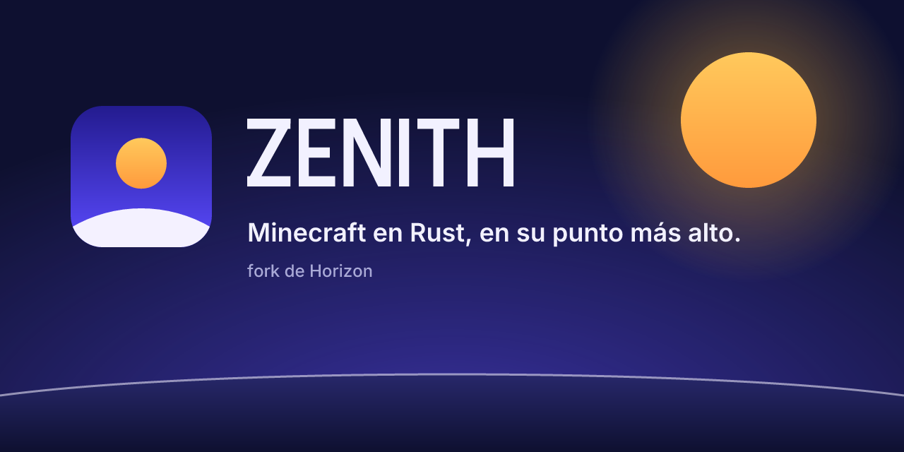

# Zenith

## What it is

Zenith is Minecraft: Java Edition 26.3 rewritten in Rust. You install it, sign in with your Microsoft account and play, alone or on servers. Besides 26.3 servers, it can join servers of older versions (from 1.20.2 on).

> **Status: early and experimental.** There is no announcement yet. What follows describes what exists today, not a promise.

## Download and install

Windows only for now. Download **Zenith Launcher** from the [Releases](https://github.com/gitzetazero/zenith/releases/latest) page (a fork of XMCL with Zenith built in; its source is in [`zenith/launcher`](zenith/launcher)):

1. Get `Zenith-Launcher-Setup-x64.exe` (per-user installer, no administrator) or `Zenith-Launcher-Portable-x64.zip` (the portable exe in a zip), and check it against the SHA-256 in the release notes.
2. Run it. Windows will warn you ("Windows protected your PC") because the build is not code-signed: choose "More info", then "Run anyway".
3. First-run steps, updates and limits are in [`zenith/README.md`](zenith/README.md). Note: Microsoft sign-in uses Zenith's own Azure app (the build embeds its public client id); until Mojang approves that app registration, Microsoft sign-in may be refused for players.

## Requirements

- Windows 10 or 11, 64-bit.
- A graphics card with Vulkan or DirectX 12.
- A Microsoft account that owns **Minecraft: Java Edition**.
- Your own copy of the game files. Zenith contains no Minecraft code or assets: the launcher downloads the game from Mojang with your account, and Zenith prepares its resources on your computer from that copy.

## How to play

1. Install and open "Zenith Launcher".
2. The first time it asks you to choose a data folder. Choose it, close the launcher and open it again: this creates the "Zenith" instance.
3. Sign in with your Microsoft account.
4. Choose the "Zenith" instance and press Play. The first time it downloads and prepares the resources: from a few seconds to a few minutes.
5. To play on a server, add it under Multiplayer as usual. Zenith detects its version. More in [`zenith/SERVERS.md`](zenith/SERVERS.md).

## What it brings

- The game engine, written in Rust.
- Multiplayer with version translation: join servers from 1.20.2 to 26.2 as well as 26.3, with a version selector for each server. **Not tested against real servers yet**: see the table in [`zenith/SERVERS.md`](zenith/SERVERS.md).
- Automatic game updates, with the signature checked before installing.
- No telemetry and no cosmetics by default.

**Coming** (does not exist yet): shaders that work well and performance presets.

## Supported servers and versions

| Server version | How you join | Status |
|---|---|---|
| 26.3 | Native | Native (26.3) |
| 1.21.7 to 26.2 | Translated | Translated |
| 1.20.2 to 1.21.6 | Translated | Translated, experimental |

You cannot join servers older than 1.20.2, Bedrock servers or servers that require mods. **No translated version has been tested against a real server yet.** The full table, how the version is chosen and how to turn the translator off are in [`zenith/SERVERS.md`](zenith/SERVERS.md).

## Build from source

You need Rust 1.90 or newer, Python 3.10 or newer, JDK 25 and, on Linux, `libasound2-dev libudev-dev`.
Preparation builds the game resources from **your own copy** of Minecraft: Java Edition 26.3 and never downloads it. Never commit game files to the repository.

1. **Client:** play 26.3 once with the official launcher. Zenith reads `~/.minecraft` (or the path in `--minecraft-dir` / `HORIZON_MINECRAFT_DIR`).
2. **Server jar:** the 26.3 server jar, passed once with `--server-jar` or `HORIZON_SERVER_JAR`.

```sh
git clone https://github.com/gitzetazero/zenith.git
cd zenith
cargo run --release -p horizon-prepare -- --prepare --server-jar ~/Downloads/server.jar
cargo run --release -p horizon-client
```

Prepared files end up in `.local/`, which git ignores: do not commit or share them. Internal names (`horizon-client`, `HORIZON_*`) were deliberately not changed; see [`ZENITH.md`](ZENITH.md).

## Known problems

- Everything is experimental and has only been tested with automated tests, not with the installer on a real Windows machine.
- Translated servers have not been tested against real servers.
- The installer and the program that prepares the game are not code-signed for Windows: SmartScreen and some antivirus programs will warn you.
- Windows only. Java mods do not work: Zenith does not run Minecraft's JVM.
- A Zenith instance only works for the game version it ships with (today 26.3).

Anything else? [Open an issue](https://github.com/gitzetazero/zenith/issues/new/choose).

## More information

- [`zenith/SERVERS.md`](zenith/SERVERS.md): server versions and how one is chosen.
- [`zenith/README.md`](zenith/README.md): player guide for the launcher.
- [`CONTRIBUTING.md`](CONTRIBUTING.md), [`SECURITY.md`](SECURITY.md) and [`CODE_OF_CONDUCT.md`](CODE_OF_CONDUCT.md): how to contribute and how to report a security problem.
- [`ZENITH.md`](ZENITH.md): guide for the people who maintain the project.
- [`zenith/branding/BRAND.md`](zenith/branding/BRAND.md): logo and colours.

## Credits and licence

Zenith is a fork of [Horizon](https://github.com/horizon-rust/horizon). Thanks to the Horizon team and its contributors: the engine is their work, and Zenith receives their improvements by syncing. If you like what they do, support them.

The code is [MIT](LICENSE). The original copyright notices are kept in the licence file, next to those of Zenith's contributors. Dependencies keep their licences ([notices](THIRD_PARTY_NOTICES.md)).

Minecraft is a trademark of Mojang Synergies AB. Zenith is not affiliated with, or endorsed by, Mojang or Microsoft. It contains no Minecraft code, assets or data: you need your own copy of Java Edition.
